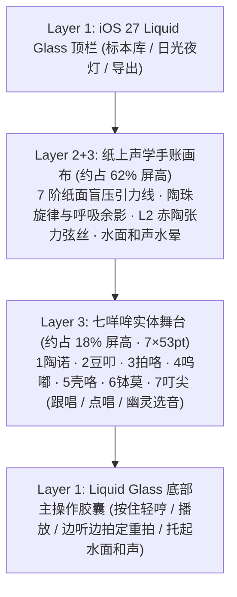

# 《咩哞 · Mie & Mou》项目立项宪法与 V2.2 窑陶声场总纲

> **文档性质**：已拍板立项基准（Project Charter · V2.2 窑陶原创架构，历史 V1.0 档案保留在下方）  
> **最新定位（v2.2.0 · 2026-11-27 拍板）**：从旧版「音乐欣赏 + 旋律编曲」升维为完全原创的 **「咩哞 · Mie & Mou」窑陶脑波共振工坊** —— 三页直觉架构（**声场**默认直达活体呼吸驻波球、**声库**四频段窑陶调音座与 12 套离线声景、**工坊**品牌铭牌与 1080×1350 共振纪念卡），支持离线双耳差频 / 外放等时共振 / 棕红暖雨 / 粉红微风 / 长按蓄力松手即发战栗瀑布 / 3 秒轻哼同频 / 闭眼夜灯零光盲操与 28 首典藏乐章。同步遵循 Apple Guideline 1.4.1 非医疗定位与完整 TestFlight 外部公测审核标准。  
> **家族序列**：`Moss（摸索）` · `Otto（台灯）` · `Mosto（魔头）` · **`Chimmo（咩哞 · Mie & Mou）`**

---

## 历史 V1.0 档案参考（保留既有底层资产与兼容约束）

---

## 一、拍板总览（Locked Decisions Record）

| 决策项 | 正式锁定方案 | 决定性理由 |
|---|---|---|
| **1. 第 4 号家族 IP 定位与命名** | **团体型 IP：`Chimmo`（中文：`咩哞` / `咩哞七声`）**，共 7 位音级小偶（对应调内 `1 2 3 4 5 6 7` 七个音级），共享 1 个家族席位 | ① 2026-11-21 实测 `Chimmo` 在 Apple App Store 全区零重名、无自动纠错撞车，且 `Moss · Otto · Mosto · Chimmo` 音韵天成； ② **7 位成员 = 7 个音级（Do–Ti）**，让「七个小矮人」不只是装饰吉祥物，而是**直接充当零乐理琴键、音准反馈与和声合唱团**； ③ 创作者钟爱的三套核心造型正好担任 **`1 · 3 · 5` 主三和弦核心铁三角**。 |
| **2. V1.0 产品范围** | **Concept A-Lite 黄金切片**（70% 脑放旋律复现 + 30% 16 首可拆解编曲标本）+ **方向 A「纸上声学手账」**线性单一画布（L1 轮廓呼吸 + L2 引力张力丝 + 水面托底和声） | 砍掉 60% 工程黑洞（L4 Tonnetz 折纸、环形↔线性双态、端侧拆轨、实时 3D），把全部工艺砸进“唱完像真曲子 + 一眼看懂和声张力”的起鸡皮疙瘩时刻。 |
| **3. 内置标本库策略** | **16 首 100% 版权自洁双源标本**：**8 首自编公版古典**（对照 1920 年代前原版总谱手工录入）+ **8 首自有版权现代编曲技法标本**（影视/动漫/City Pop 情绪骨架） | 彻底避开 MuseScore / Kunstderfuge / PDMX(12.29% 冲突) / IMSLP NC 版权暗礁，同时解决“全古典博物馆次日吃灰”问题；每首标本的「水面和声色温」均可一键借给用户自己的脑放旋律。 |
| **4. 导出与生态边界** | **3 种完全离线导出**：① `.m4a` 高质感音频；② 1080p 竖屏「纸上陶珠 + 七咩哞跟唱」动态谱卡视频（核心口碑传播载体）；③ 标准 `.mid`（收于分享菜单二级项） | 零基础用户不被专业格式打扰，创作者/音乐人又能无缝带进 GarageBand / Logic Pro；动态谱卡自带小红书/X/B站自然裂变力。 |
| **5. 商业与隐私模式** | **完全离线、无账号、无广告、无追踪、无打卡焦虑**；采用 **「免费体验 + 一次买断解锁完整版」**（体验版含完整哼捕 + 毛毡钢琴 + 4 首标本；买断解锁 16 首全标本 + 全现代和声色温 + 钢片琴/拨弦音色 + 高清动态谱卡与 MIDI 导出） | 比“纯付费下载”大幅降低零基础尝鲜门槛（声音与手感必须亲耳试过才惊艳），同时坚守家族反订阅制、一次买断的长期口碑信誉。 |

---

## 二、团体型 IP 正典：《咩哞七声 · The Seven Chimmos》

### 2.1 核心巧思：把 7 个音级的「音乐力学」长成 7 个小偶的身体

零乐理用户不需要背“主音、中音、属音、导音”，他们只要认识这 7 只坐在矮木架上的哑光窑陶小偶。**无论曲子是什么调，7 只咩哞永远代表当前调里的 `1–7` 级**（就像首调唱名法）：

| 音级 | 成员名 | 声学器物原型（全员哑光窑陶软胶） | 音乐角色与无声微反应 | 主色 / 点缀色（WCAG 实测） |
|---|---|---|---|---|
| **1 · 家 (Do)** | **陶诺 · Taono** *(1-3-5 核心)* | **赤陶倒钟共鸣铃**（不对称软胶音叉耳 + 胸口声孔与古铜共鸣珠） | 最稳重的归家老大；旋律落到他身上时，全员松气、纸面漾开归家地平线光环 | `#C4513A` (日 `4.14:1` / 夜 `3.37:1`) 点缀 `#4A261E` / 金 `#FFB84D` |
| **2 · 迈步 (Re)** | **豆叩 · Doko** | **暖杏陶小木鱼圆豆**（矮圆体 + 顶缘一道极简水平声槽） | 好奇探路的小弟；身体天生微前倾 `5°`，走出家门第一步时的轻快衔接 | `#BC6E28` (日 `3.51:1` / 夜 `3.97:1`) 点缀 `#5A3516` |
| **3 · 晴雨 (Mi)** | **拍咯 · Plokko** *(1-3-5 核心)* | **胭脂珊瑚不倒翁平衡偶**（横向双翼厚响耳 + 深胡桃静音底环） | **大调 / 小调晴雨表**：晴朗大调时双耳轻扬微笑，切至微酸小调时身体略沉、双耳柔垂；哼唱时身体左右倾角实时充当音准水平仪 | `#CF5B68` (日 `3.54:1` / 夜 `3.93:1`) 点缀 `#3A2C2A` / 金 `#FFC45A` |
| **4 · 悬步 (Fa)** | **呜嘟 · Udo** | **影青瓷小陶笛圆蛋**（斜仰卵形 + 侧肩两粒焦铜小气孔） | 轻吸一口气的浮空感；微微向 #3 拍咯方向倾靠（直观呈现 4→3 下行引力） | `#4E8280` (日 `3.93:1` / 夜 `3.55:1`) 点缀 `#244241` |
| **5 · 远望 (Sol)** | **壳咯 · Corllo** *(1-3-5 核心)* | **宣瓷暖白螺旋号角贝**（水滴高体 + 右侧焦铜对数螺旋听筒耳） | 撑起整句天空的二当家；与 #1 陶诺构成最稳固的五度支柱，高潮处由螺心透出暖金余光 | `#EFE7D8` (夜 `12.56:1`) **日光锚点** `#B85D3B` (`4.06:1`) + 底影 |
| **6 · 怀旧 (La)** | **钵莫 · Bomo** | **焙赭陶小手碟圆钵**（宽肩微扁 + 顶面浅洼淡金釉面） | 沉静内敛的温柔阴影；流行与动漫副歌最催泪的“6 级微酸”情绪担当 | `#9A624B` (日 `4.49:1` / 夜 `3.10:1`) 点缀 `#E8BD6B` (夜 `8.76:1`) |
| **7 · 踮脚 (Ti)** | **叮尖 · Tinki** | **窑赭陶小陀螺尖芽**（窄身尖底微斜 `10°` + 顶上一颗亮金珠） | **全团最急着回家的张力担当**：永远踮脚朝 #1 陶诺方向急切倾斜微颤；当 #1 紧接着响起时，瞬间稳落回正，零基础 1 秒看懂“导音解决” | `#B37418` (日 `3.49:1` / 夜 `3.99:1`) 点缀 `#FFC45A` (夜 `9.77:1`) |

### 2.2 团体型 IP 的三大工艺与交互设计规则
1. **iPhone 单屏排布与触控人体工学**：7 位成员横向并排坐于画布底部的暖木/浅纸舞台上（393pt–440pt 屏宽 → 每位宽度 **`53–58pt`**，高于 Apple HIG `44pt` 最小触控热区），手指可直接点唱或滑奏，零拥挤误触。
2. **高/低八度与调外半音的优雅处理（绝不克隆 21 只角色）**：
   - **高八度**：该成员轻盈上浮 `6pt` 并在头顶浮现一圈极淡暖金光环；
   - **低八度（低音托底）**：该成员微沉蓄力，脚下漾开靛蓝低音水纹；
   - **调外借用音（如 `#4` / `b7`）**：上方纸面落下一颗菱形棱镜音珠，下方相邻两位成员同时微微相向侧耳，中间亮起一小簇赤陶张力火花。
3. **App Icon 29pt 辨识方案 & Blender 管线**：
   - **App Icon**：不强塞 7 只蚂蚁小人，采用 **`1-3-5` 主三和弦三人组**构图——`1号 陶诺` 居中偏前做主视觉锚点，`5号 壳咯` 的螺旋耳与 `3号 拍咯` 的珊瑚耳翼柔和探在左右后方（延续 `mossling` 的 `Duo.behind` 同比例尺构图法），缩至 29pt 依然清晰可辨。
   - **资产管线**：编写单一参数化脚本 `Tools/ip/chimmo3d.py`（Blender Cycles `bpy`，统一 `rubber(rough=0.55, sss=0.06, bump=(700, 0.025))` 材质与上釉眼、产品摄影布光），为每位成员导出 4 态预渲染高工艺图集（`day_idle` / `day_sing` / `night_idle` / `night_sing`），在运行时叠加 SwiftUI 物理弹簧与倾角动画——**零实时 3D GPU 争抢，稳守 120Hz 与不发烫**。
   - **家族表达红线**：全员**绝对不说话**（零气泡、零字幕、零嘴型），静默时仅安静呼吸，开启「减弱动态效果」时保持静止清晰态。

---

## 三、V1.0 核心闭环与界面架构（Concept A-Lite）

### 3.1 四步零乐理脑放复现流（已纳入全部 Q02 审计修正）
1. **单音节轻哼捉珠（`SwiftF0 v0.3.0`）**：按住底部录音珠，屏幕以无文字呼吸光环温和引导用 `da / la` 轻哼。端侧运行 14K 参数 `SwiftF0` + 前置 AGC 归一化 + 响度门限，松手 `≤200ms` 后上方纸面凝结出一串陶珠，下方对应咩哞依次亮起应答。
2. **一指幽灵纠偏 + 耳机有声拖珠**：遇跑调或大跳压缩处，纸面与对应咩哞上方浮现半透明**调式内邻音幽灵珠**，轻点即“啪嗒”吸附并以毛毡钢琴实时发声；亦可直接按住任意陶珠上下微拖，或直接点按下方 7 只咩哞逐音微修。
3. **边听边拍锚定重拍（Tap-Along）**：录时不强开节拍器；回放时轻点空白纸面 4–8 下跟着点头，系统同时锁死 BPM 与第 1 拍重拍落点（解决弱起错位），并提供无损「归整焦距」滑槽在“自然呼吸 ↔ 稳健律动”间自由滑动。
4. **向上托起水面（现代和声色温）**：从画布底部把玻璃水面向上一托，零术语切换 3 种高审美现代开放和声色温（`毛毡暖阳 · add9/maj7`、`透明水波 · sus2/四度悬浮`、`电影微光 · 6级微酸/斜杠低音`），亲眼看见同一颗旋律陶珠随底层换底瞬间点亮或松解张力光丝。

### 3.2 16 首 100% 版权自洁双源标本库清单（V1.0 规划）
> 所有公版切片均由团队对照 1920 年代前原版扫描总谱自行录入并手工标注句法与和声功能（严禁打包 MuseScore / Kunstderfuge / IMSLP NC 文件）；每首 16–32 小节精粹，开箱即赏、支持**独奏主旋律 / 独奏水面和声 / 0.5× 显微慢放 / 直接借用其和声色温**。

| 组别 | 8 首精选曲目 / 原创编曲技法标本 | 编曲家视觉看点（零基础 30 秒必懂的“哇”时刻） |
|---|---|---|
| **A. 自编公版古典（8 首）** | 1. 巴赫《C大调前奏曲》BWV 846 2. 巴赫《二部创意曲 No.1》BWV 772 3. 萨蒂《吉诺佩蒂 No.1》 4. 德彪西《月光》引子 5. 肖邦《升C小调夜曲》遗作主题 6. 帕赫贝尔《卡农》低音与对位 7. 莫扎特《小星星变奏曲》对比切片 8. 贝多芬《致爱丽丝》A段张力解决 | 看懂“分解和弦织成流动光瀑”、“左右手追逐对话”、“大七和弦的清冷悬浮”、“#7 叮尖反复绷紧又落回 #1 陶诺的经典解决”、“同一条低音线如何托起层层递增的旋律塔”。 |
| **B. 自有版权现代技法（8 首）** | 1. 《夏风四度》（久石让式 4-5-3-6 悬浮） 2. 《雨后半音》（坂本龙一式借用离调色彩） 3. 《午夜海岸》（City Pop 2-5-1 霓虹七和弦） 4. 《白昼微酸》（日系大调转关系小调情绪切换） 5. 《留白茶室》（五声东方旋律配现代 `add9` 托底） 6. 《灯下钟摆》（三拍子华尔兹弹性呼吸） 7. 《慢行楼梯》（下行斜杠贝斯线 `C-G/B-Am-G` 催泪机制） 8. 《星尘对话》（双旋律反行撑开空间感） | 100% 自有版权却直击当代年轻人心智——亲眼看懂“为什么加一个斜杠低音就瞬间催泪”、“为什么大调和声下换一颗小调 #3 拍咯情绪全变”。 |

---

## 四、iOS 原生技术架构与硬核避坑设计

| 层级 | 技术选型 | 关键工程纪律（针对 Q02 排雷） |
|---|---|---|
| **UI 与画布** | SwiftUI（iOS 27）+ Liquid Glass 导航层 + 120Hz `Canvas` / Metal 着色器（水晕、余影、张力弦丝） | 滚动与画布层 `glassEffect == 0`；全部颜色叠加线形/形状/CoreHaptics 双编码（色盲与 VoiceOver 语义读音同步开发）。 |
| **单音哼唱引擎** | **`SwiftF0 v0.3.0`**（MIT，14,386 参数，CoreML / ONNX Runtime，16kHz） | 前置 AGC 峰值归一化（防深夜轻哼漏检）+ `loudness_db` 门限（防电视背景音误触发）+ 自研音阶吸附与大跳压缩矫正后处理。 |
| **音频合成与路由** | `AVAudioEngine` + `AVAudioUnitSampler` + 空间卷积混响；自制精调 `.caf` 音色包（**毛毡钢琴 + 钢片琴 + 轻拨弦，总计 ≤ 25 MB**） | **强制半双工音频状态机**：录音态关闭外放监测并优先机身麦（杜绝蓝牙耳机自动跌入 16kHz HFP 电话音质与 `VoiceProcessingIO` 毁音质）；松手切回 `.playback` 48kHz 高保真 A2DP；内置来电/闹钟中断自动恢复。 |
| **离线存储与合规** | 本地 SwiftData / JSON 快照 + 不可变 `UndoStack`；零网络权限（CI 沿用 `mossling` 的零联网监控检查） | 安装包严格压在 **60–90 MB** 内（远低于 Apple 200MB 蜂窝警告线）。 |

---

## 五、立即可执行的推进路线图：7 天白盒 Spike → 建仓与 App Store ID

### Phase 0：7 天真机白盒验证门控（先用临时代号私仓，不写精美 UI）
1. **Day 1–3｜真机声学与路由实测**：在真实 iPhone 跑通 `SwiftF0 v0.3.0` + 响度/AGC 后处理，采集 15–20 条真实业余噪声哼唱（安静、空调/咖啡馆 10–15dB 噪、轻声、大跳音程），同步实测 AirPods 录播切换零爆音。  
   - **Pass 红线**：音符级 F1 ≥ 80%、八度泛音鬼影 ≤ 5%、10 秒音频后处理 ≤ 200 ms。
2. **Day 4–5｜毛毡钢琴 + 现代水面和声听觉验证**：挂载 ≤25MB 毛毡钢琴采样与 3 套现代开放和声，串联幽灵珠一指纠偏 + 边听边拍重拍对齐，请 5 位零乐理受试者盲测。  
   - **Pass 红线**：≥ 4/5 认可“听得出是我哼的歌且托起水面后明显惊艳”，单句错音 ≤ 30 秒修准。
3. **Day 6–7｜30 秒读图盲测 + 品牌占位核验**：用极简画布 + 7 位咩哞交互原型测 L1/L2 张力光丝可理解性；同时登录 **App Store Connect** 实测抢占正式名称。  
   - **Pass 红线**：≥ 4/5 零乐理者在零文字教学下 30 秒说出“哪处最紧张、哪只小偶最急着回家”。

### Phase 1：正式建库与 App Store ID 准备清单（Phase 0 全绿后立即执行）
- **GitHub 仓库名**：`mjuvdeysii/chimmo`（延续 `mossling` 极简小写命名风）
- **Bundle ID**：`app.chimmo`（延续 `app.mossling` 家族规范）
- **App Store 名称草案**：
  - 简体中文：`咩哞 - 捉住脑海里的旋律`（或 `咩哞 · Chimmo`）
  - 英文：`Chimmo — Hum & See Music`
- **首轮视觉与研发分派**：
  - `D02 / D03`：编写 `Tools/ip/chimmo3d.py`，在 Blender Cycles 下跑出 7 位咩哞同框图、29pt `1-3-5` App Icon 剪影实测图与日光/夜灯双态色卡；
  - `E01`：按 `project.yml`（XcodeGen）初始化 iOS 27 工程 + CI 零联网/截图/无障碍测试流水线（复用 `mossling` 与 `OTTOSSOM` 成熟 CI 架构）。
